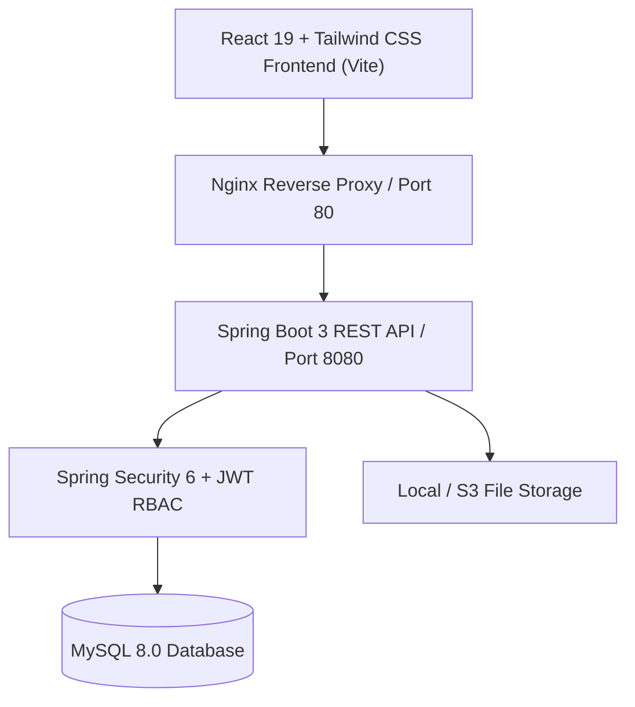

# 🎓 EduManage - Enterprise Full-Stack Education Management Platform

A high-performance, secure, and scalable Education Management and LMS platform engineered with **Java Spring Boot 3**, **React 19 / Vite**, **MySQL 8.0**, **JWT Authentication with Role-Based Access Control (RBAC)**, and **Manual UPI Transaction Verification**.

---

## 🌟 Key Highlights & Feature Matrix

### 🔐 1. Authentication & Security
- **Stateless JWT Flow:** Custom `JwtAuthenticationFilter` validating tokens on every protected request.
- **Strict Role-Based Access Control (RBAC):**
  - `ADMIN`: Complete command center, revenue metrics, payment approvals, student directory, LMS video/notes/assignment management.
  - `STUDENT`: Enrolled courses, interactive classroom, live batch chat, assignment submission, UPI receipt tracking, 16-field profile editing.
- **Password Recovery & Modification:** Secure token generation and BCrypt-hashed credential updates.

### 📝 2. University-Grade 16-Field Student Registration
Collects complete student profile records adhering to institutional standards:
1. `fullName`
2. `email`
3. `phone`
4. `alternatePhone`
5. `parentName`
6. `parentPhone`
7. `dateOfBirth`
8. `gender`
9. `qualification`
10. `collegeName`
11. `passingYear`
12. `address`
13. `city`
14. `state`
15. `pincode`
16. `profilePhotoUrl`

### 💳 3. Manual UPI Payment Verification Workflow
- Direct UPI QR Code / VPA payment (`admin@edumanage.upi`).
- Students submit their **12-digit UTR reference** number and optional screenshot receipt upon enrollment.
- Payments stay in `PENDING` state until audited.
- Admin reviews the 12-digit UTR in the **Payment Approvals** dashboard and clicks **Approve**.
- Approval automatically creates an `APPROVED` enrollment, allocates the student to their selected batch, and unlocks the complete classroom hub.

### 💻 4. Interactive Learning Classroom Hub
- **Video Lectures Player:** YouTube embedded player & native MP4 support, sequenced playlist, session durations, and topic overviews.
- **Study Resources & Notes:** Downloadable PDFs, presentation slides, and cheatsheets.
- **Assignments & Grading:** Problem statements, due dates, student solution code submissions with file uploads, and faculty grading/feedback.
- **Cohort Community Chat:** Real-time cohort discussion board for students and instructors.
- **Faculty Broadcast Notices:** Course-wide bulletins and live class alerts.

---

## 🛠️ Architecture & Tech Stack



| Layer | Technology |
| :--- | :--- |
| **Frontend** | React 19, Vite, Tailwind CSS, Lucide Icons, Recharts, Axios |
| **Backend** | Java 21, Spring Boot 3.4, Spring Security 6, Spring Data JPA, Hibernate |
| **Database** | MySQL 8.0 (InnoDB, UTF-8mb4) |
| **Authentication** | JSON Web Tokens (io.jsonwebtoken / jjwt 0.12.5) |
| **File Storage** | Local Multipart Storage (`/uploads/`) & Cloud Ready |
| **DevOps & Containers**| Docker, Docker Compose, Nginx Alpine |

---

## 🚀 Getting Started Locally

### Prerequisites
- **Java JDK 21+**
- **Node.js 20+** & **npm**
- **MySQL 8.0+** (or Docker)

### Option 1: One-Click Docker Compose (Recommended)

Run the full stack with persistent MySQL, Spring Boot backend, and Nginx React frontend:

```bash
docker-compose up --build
```

- **Frontend Application:** `http://localhost:3000` or `http://localhost`
- **Backend REST API:** `http://localhost:8080/api`
- **MySQL DB:** `localhost:3306`

---

### Option 2: Running Backend & Frontend Standalone

#### 1. Setup MySQL Database
Create the database and load schema:
```sql
CREATE DATABASE edumanage_db;
-- Run script from database_schema.sql
```

#### 2. Run Spring Boot Backend
```bash
cd backend
./mvnw spring-boot:run
```
*The backend starts at `http://localhost:8080`.*

#### 3. Run React Frontend
```bash
cd frontend
npm install
npm run dev
```
*The frontend starts at `http://localhost:5173`.*

---

## 🔑 Default Credentials (Seed Data)

| Role | Email | Password | Access Area |
| :--- | :--- | :--- | :--- |
| **Administrator** | `admin@edumanage.com` | `admin123` | `/admin/dashboard` |
| **Student** | Registered via 16-field form | Selected during registration | `/student/dashboard` |

---

## 📡 Key REST API Endpoints

### 1. Authentication (`/api/auth`)
- `POST /api/auth/register` - 16-field student registration
- `POST /api/auth/login` - Authenticate & obtain JWT
- `POST /api/auth/forgot-password` - Request reset token
- `POST /api/auth/reset-password` - Reset password with token
- `POST /api/auth/change-password` - Authenticated password update

### 2. Courses & Batches (`/api/courses`, `/api/admin/courses`, `/api/admin/batches`)
- `GET /api/courses/public` - Browse published courses
- `GET /api/courses/public/{id}` - Course curriculum & batch details
- `POST /api/admin/courses` - Create new course
- `PUT /api/admin/courses/{id}` - Edit course details
- `POST /api/admin/batches` - Create cohort batch
- `GET /api/admin/batches` - List all batch schedules

### 3. Payments & Verification (`/api/student/payments`, `/api/admin/payments`)
- `POST /api/student/payments` - Submit 12-digit UTR payment receipt
- `GET /api/student/payments` - View student's payment receipts
- `GET /api/admin/payments` - List all/pending payments
- `PUT /api/admin/payments/{id}/verify` - Approve/reject UPI payment

### 4. LMS Classroom (`/api/learning`)
- `GET /api/learning/courses/{courseId}/videos` - Fetch lecture playlist
- `GET /api/learning/courses/{courseId}/notes` - Download course notes & PDFs
- `GET /api/learning/courses/{courseId}/assignments` - Course assignments
- `POST /api/learning/assignments/submit` - Submit assignment solution
- `PUT /api/learning/submissions/{id}/grade` - Grade submission & give feedback
- `GET /api/learning/batches/{batchId}/messages` - Batch chatroom history
- `POST /api/learning/batches/{batchId}/messages` - Send batch message

---

## 🛡️ License
This project is built and maintained as an enterprise-grade education management system.
